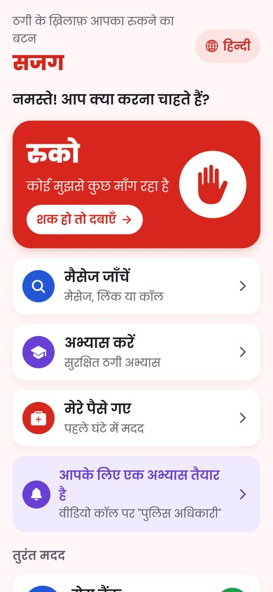
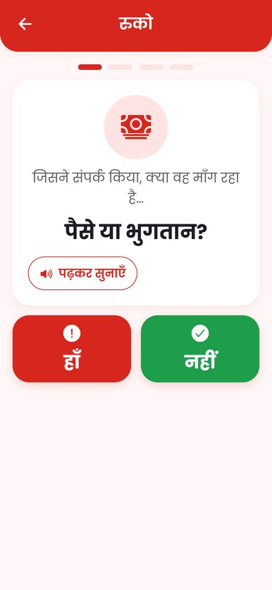
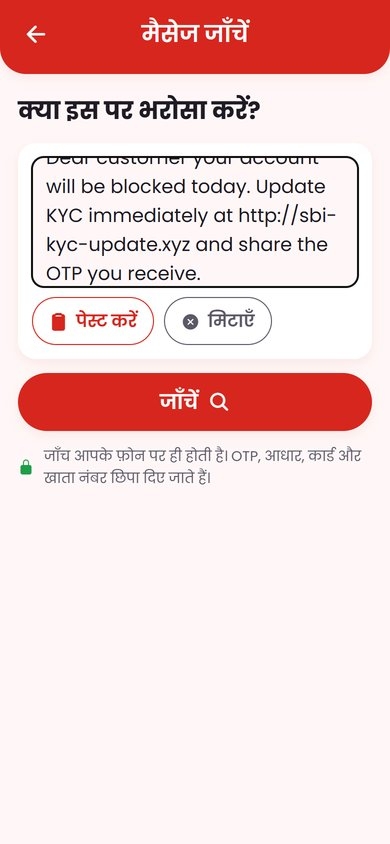
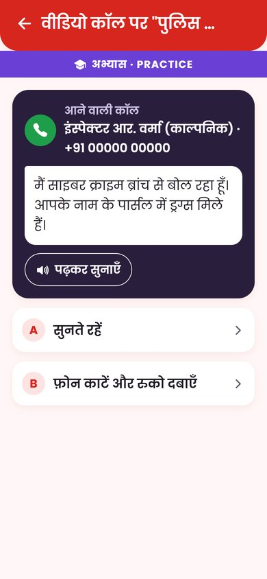

# Sajag (सजग) — the scam-stopping pause

**Sajag** is a voice-first, multilingual app (हिन्दी · मराठी · English) that helps senior citizens and
first-time digital users stop online financial scams **before they pay**. It teaches one habit:

> When someone who contacted you asks for **money, an OTP/PIN, an app install or secrecy** — press **RUKO** (pause),
> then check, call back on a number you already trust, and ask family.

Built by **Team Bit Flare** (Keystone School of Engineering) for **YCCE HackKumbh 2026** —
problem statement: *Digital Literacy and Cyber Fraud Awareness Assistant for Senior Citizens*.

---

## Try it now

### 1. Web app (works anywhere, no install)

**Live link:** https://sajag.adnan2005t.workers.dev


Scan this QR with your phone camera, or open the link in Chrome.
Tip: in Chrome tap **⋮ → Add to Home screen** so it opens like an app.

### 2. Android app in Expo Go (permanent QR — no computer needed)


1. Install **Expo Go** from the Google Play Store (Android).
2. Open **Expo Go** → tap **Scan QR code** → scan the QR above.
   Or tap **Enter URL manually** and paste:
   ```
   exp://u.expo.dev/6583adf9-d16c-48e3-a420-9a628ffeee58?runtime-version=exposdk%3A58.0.0&channel-name=preview
   ```
3. Wait for the first download (about 30 seconds), choose your language and tap **शुरू करें / Let's get started**.

This link always opens the **latest published version** (EAS Update, `preview` channel), so it keeps working after new updates.
Expo Go must support **SDK 58** — update Expo Go from the Play Store if it shows an SDK error.

**Publishing a new version to the same QR** (maintainers, needs the Expo account that owns the project):
```bash
npx eas-cli login
npx eas-cli update --channel preview --environment preview --platform android --message "what changed"
```

### 3. Run from source with Expo Go (for developers)

When you run the project yourself, Expo creates a temporary QR code on **your own computer**.

1. Install **Expo Go** from the Google Play Store on your Android phone.
2. On your computer, install **Node.js 22 or newer** and **Git**.
3. Clone and start the project:
   ```bash
   git clone https://github.com/Addy-coder786/Sajag.git
   cd Sajag
   npm install
   npx expo start
   ```
4. A **QR code** appears in the terminal. Connect the phone to the **same Wi-Fi** as the computer.
5. Open **Expo Go → Scan QR code** and scan it.
   Or tap **Enter URL manually** and type the URL printed under the QR, for example `exp://192.168.1.5:8081`
   (use your computer's own IP address shown in the terminal).
6. The first load takes about a minute. Choose your language and tap **शुरू करें / Let's get started**.

**Phone can't connect?** (college or office Wi-Fi often blocks this)
- Allow Node.js through the Windows Firewall when Windows asks, **or**
- Use a tunnel, which works across different networks:
  ```bash
  npx expo start --tunnel
  ```
  then scan the new QR code in Expo Go.

---

## Features

| | Feature | What it does |
|---|---|---|
| ✋ | **RUKO flow** | 10-second breathing ring, then the Four Asks — one question per screen with big Yes/No buttons. Any "Yes" → "Stop. Hang up." with one-tap calls to your bank and trusted people |
| 🔍 | **"Is This Safe?" checker** | Paste an SMS/WhatsApp message or link. Checked **on the phone**; OTPs, Aadhaar, card and account numbers are hidden. Result: *Scam signs found* / *Can't be sure* / *No common scam signs* — it **never says "safe"** |
| 🎓 | **Practice drills** | Fake scam calls and chats (digital arrest, KYC SMS, family emergency, QR refund) with a PRACTICE label, clues on mistakes, and booster drills after 1 week and 1 month with a new story |
| 🆘 | **I lost money** | First-hour steps: call 1930, block through your bank, report at cybercrime.gov.in, save proof, ready-written complaint to copy, RBI liability rights for today's date |
| 👪 | **Trusted people** | Up to 5 people with one-tap calls; family safe-word reminder. Stored only on the phone |
| ☎️ | **Helplines** | Verified directory (1930, Chakshu, 1909, RBI Ombudsman, SEBI Check, UIDAI 1947, Elderline 14567, 112) with source and check date |
| 🌐 | **Elder-friendly** | Hindi / Marathi / English, voice read-aloud, 3 text sizes, large buttons, works offline, no login, no OTP |

<p>
  
  
  
  
</p>

*(Screenshots use fictional names and numbers.)*

---

## Run, test and build

```bash
npm install            # install dependencies
npx expo start         # start dev server (scan QR with Expo Go)
npx expo start --web   # run in the browser
npm test               # scam-engine tests (Jest)
npx tsc --noEmit       # type check
npx eslint src         # lint
npx expo export --platform web   # production web build → dist/
```

**Deploying the web build** (any static host works — Cloudflare Workers, Netlify, GitHub Pages):
upload the `dist/` folder and make unknown paths fall back to `index.html` (single-page app).

---

## How the scam check works (`src/engine/`)

| File | Role |
|---|---|
| `mask.ts` | Hides OTPs, Aadhaar, PAN, card numbers (Luhn-checked), phone/account numbers, UPI IDs and emails |
| `rules.ts` | The Four Asks + Indian scam patterns (digital arrest, KYC, power cut, prize, investment, "scan to receive", family emergency, pension, courier, `.apk`) in English, Hindi, Marathi and Hinglish. Each rule records its basis, source and review date |
| `urls.ts` | Offline link checks: `.apk` downloads, short links, IP hosts, punycode, risky endings, bank look-alikes |
| `analyze.ts` | Verdict policy — rules set the minimum risk; there is no "safe" verdict. Delivery OTPs shared in person are the one allowed exception |

## Project structure

```
src/
  app/          screens (Expo Router): home, language, ruko, check, practice, lost, contacts, helplines, settings
  components/   shared UI (header, bottom bar with RUKO button, contact cards, countdown ring)
  engine/       offline scam-detection engine + tests
  content/      practice drills and verified helpline directory
  i18n/         Hindi, Marathi and English text
  state/        settings saved on the device
docs/           content-review checklist, screenshots
```

**Tech:** Expo SDK 58 · React Native · TypeScript · Expo Router · expo-speech · AsyncStorage · Jest

## Privacy & safety

- No account, no login, no OTP, no backend — everything runs on the phone.
- Never stores OTPs, PINs, passwords, card/account numbers or the family safe word.
- No SMS, contacts or call-log permissions; call buttons open the phone's dialer.
- Practice drills use fictional names, numbers and a fictional "Bharat Demo Bank".

## Notes

- Hindi and Marathi text is a first draft and should be reviewed by native speakers before a pilot — see `docs/CONTENT_REVIEW.md`.
- Helpline numbers and RBI rules should be re-verified before each release (each entry lists its source and check date).

## Team Bit Flare

Adnan Shaikh (Team Leader) · Sanidhya Borade · Aryan Hinge · Aakash Tribhuvan — Keystone School of Engineering

License: MIT
